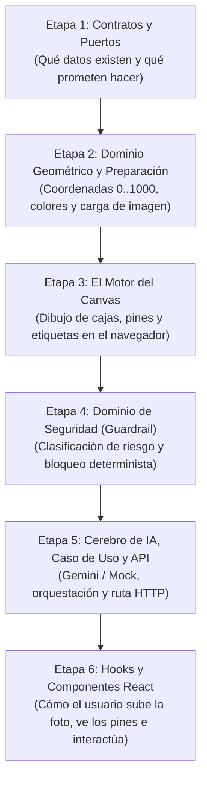

# 00 — Guía de Lectura del Proyecto: Cómo Entender Fixen Paso a Paso

Este documento es el **mapa de estudio** de **Fixen**. Su objetivo es responder en todo momento a la pregunta:

> *"Si quiero entender cómo funciona una pieza (por ejemplo, el Canvas de imágenes o el bloqueo de seguridad), ¿qué archivo debo leer primero, por qué, y a qué archivo debo pasar después?"*

---

## 1. Mapa Mental Rápido (El Orden Lógico)

El proyecto está construido con **Arquitectura Limpia y Principio de Responsabilidad Única (SRP)**. Eso significa que ningún archivo hace "todo a la vez": las estructuras de datos, las fórmulas matemáticas, el dibujo en navegador, la llamada a la IA y la interfaz de React viven en capas separadas.

Si intentas leer primero un componente de React o un servicio complejo sin haber visto el **Contrato** que recibe, parecerá magia. En cambio, si sigues este orden de 6 etapas, cada archivo tendrá sentido inmediato:

---

## 2. Ruta Guiada Archivo por Archivo

### Etapa 1: El Vocabulario Base (Contratos y Puertos)
**Objetivo:** Entender qué forma tienen los datos antes de ver cualquier lógica o función compleja.

1. **Lee primero:** [`lib/contracts/diagnosis.contract.ts`](../lib/contracts/diagnosis.contract.ts)
   - **Qué aprenderás aquí:** Qué es un `NormalizedBoundingBox` (coordenadas de `0` a `1000`), qué contiene una falla detectada (`FaultAnnotation`), qué niveles de riesgo existen (`LOW`, `MEDIUM`, `HIGH`) y cómo luce la respuesta completa (`DiagnosisResultDTO`).
   - **Por qué es el paso #1:** Tanto el Canvas como la IA y los componentes de React hablan este mismo idioma.
2. **Lee después:** [`lib/ports/image-annotator.port.ts`](../lib/ports/image-annotator.port.ts) y [`lib/ports/vision-analyzer.port.ts`](../lib/ports/vision-analyzer.port.ts)
   - **Qué aprenderás aquí:** Son interfaces de apenas 15–20 líneas. Te muestran qué recibe y qué devuelve el anotador de imágenes (`annotateImage`) y el analizador de visión (`analyzeHomeIssue`), sin distraerte todavía con *cómo* lo hacen por dentro.
   - **Documentación de apoyo:** [`docs/01-domain-contracts.md`](./01-domain-contracts.md).

---

### Etapa 2: La Matemática Pura y la Imagen antes del Canvas
**Objetivo:** Entender cómo se calculan los píxeles, colores y posiciones **antes** de tocar la API `<canvas>` del navegador.

3. **Sigue con:** [`lib/domain/bounding-box.ts`](../lib/domain/bounding-box.ts)
   - **Qué aprenderás aquí:** La IA nunca devuelve píxeles fijos (porque una foto puede medir `4000x3000` y otra `800x600`); devuelve coordenadas normalizadas `[0..1000]`. Aquí verás dos funciones puras: `sanitizeNormalizedBox` (que corrige cajas invertidas o fuera de rango) y `normalizedBoxToPixelRect` (que convierte ese `0..1000` a píxeles `x, y, width, height` reales de la foto).
4. **Sigue con:** [`lib/domain/severity-palette.ts`](../lib/domain/severity-palette.ts) y [`lib/domain/annotation-layout.ts`](../lib/domain/annotation-layout.ts)
   - **Qué aprenderás aquí:**
     - En `severity-palette.ts` verás qué colores exactos corresponden a `LOW` (verde), `MEDIUM` (ámbar) y `HIGH` (rojo).
     - En `annotation-layout.ts` (`computeBadgePlacement`) verás la fórmula que decide dónde colocar la etiqueta de texto y el pin circular para que **nunca se salgan de los bordes de la imagen** si el desperfecto está muy arriba o pegado a la derecha.
   - **Documentación de apoyo:** [`docs/03-image-annotation.md`](./03-image-annotation.md).
5. **Sigue con:** [`lib/infrastructure/image/load-image.ts`](../lib/infrastructure/image/load-image.ts) y [`lib/infrastructure/image/image-preparer.ts`](../lib/infrastructure/image/image-preparer.ts)
   - **Qué aprenderás aquí:** Cómo un archivo `File` o una URL se convierte en un objeto `HTMLImageElement` listo para dibujarse (`loadImage`) y cómo se comprime/redimensiona a un máximo de `1280px` en JPEG antes de enviarlo al servidor (`prepareImageForUpload`).

---

### Etapa 3: El Motor Gráfico del Canvas
**Objetivo:** Ahora que ya conoces el contrato (`FaultAnnotation`), la conversión a píxeles (`normalizedBoxToPixelRect`), el cálculo anti-desborde (`computeBadgePlacement`) y la carga (`loadImage`), el archivo del Canvas se vuelve 100 % transparente.

6. **Lee ahora:** [`lib/infrastructure/image/canvas-image-annotator.service.ts`](../lib/infrastructure/image/canvas-image-annotator.service.ts)
   - **Qué aprenderás aquí:**
     - Cómo `annotateImage()` crea un `<canvas>` del tamaño exacto de la fotografía y dibuja la foto original de fondo.
     - Cómo recorre cada `FaultAnnotation` llamando a `drawSingleAnnotation()`.
     - Cómo dibuja el recuadro semitransparente con esquinas redondeadas (`drawRoundedRect`), la pastilla oscura con la descripción de la falla y el círculo numerado (`1`, `2`, `3`).
     - Cómo al final exporta el lienzo a `canvas.toDataURL("image/png")` para que el usuario pueda ver o descargar la foto marcada.
   - **Documentación detallada de sus funciones:** [`docs/03b-canvas-annotator-and-adapters.md`](./03b-canvas-annotator-and-adapters.md).

---

### Etapa 4: ¿Ya entendiste el Canvas? Lo que sigue es el Guardrail de Seguridad
**Objetivo:** Una vez que entiendes cómo se marcan los problemas en la foto, el siguiente paso es comprender **cómo decide Fixen si es seguro darle instrucciones al usuario o si debe bloquearlas**.

7. **Pasa a leer:** [`lib/domain/risk-policy.ts`](../lib/domain/risk-policy.ts)
   - **Qué aprenderás aquí:** Qué palabras o señales activan la sospecha de peligro mortal (`containsCriticalHazard`: cables expuestos, humedad junto a enchufes, olor a gas, grietas estructurales) y cómo `resolveEffectiveRiskLevel` aplica el **sesgo escéptico** (ante la duda, siempre sube el riesgo a `HIGH`).
8. **Sigue con:** [`lib/domain/safety-guardrail.ts`](../lib/domain/safety-guardrail.ts)
   - **Qué aprenderás aquí:** La función más importante de seguridad del proyecto: `enforceHighRiskSafetyGuardrail()`. Verás que es código TypeScript determinista (no depende de que la IA "haga caso"): si el riesgo efectivo es `HIGH`, **destruye cualquier plan de reparación (`repairPlan: null`)**, activa `isRepairBlocked: true` y fuerza la recomendación de un especialista certificado.
   - **Documentación de apoyo:** [`docs/02-safety-guardrail.md`](./02-safety-guardrail.md).

---

### Etapa 5: ¿De dónde sale el diagnóstico? (IA, Caso de Uso y API)
**Objetivo:** Conectar la entrada del usuario con el analizador visual (Gemini o Demo) y el Guardrail de la Etapa 4.

9. **Lee el adaptador de IA:**
   - [`lib/infrastructure/ai/system-prompts.ts`](../lib/infrastructure/ai/system-prompts.ts): Las instrucciones de sistema que obligan al modelo a devolver coordenadas `[0..1000]` y actuar con cautela.
   - [`lib/infrastructure/ai/diagnosis-response-schema.ts`](../lib/infrastructure/ai/diagnosis-response-schema.ts) y [`lib/infrastructure/ai/diagnosis-response-parser.ts`](../lib/infrastructure/ai/diagnosis-response-parser.ts): Cómo se valida y limpia el JSON que devuelve el modelo antes de confiar en él.
   - [`lib/infrastructure/ai/vision-analyzer.adapter.ts`](../lib/infrastructure/ai/vision-analyzer.adapter.ts) (conexión real con Google Gemini) y [`lib/infrastructure/ai/mock-vision-analyzer.adapter.ts`](../lib/infrastructure/ai/mock-vision-analyzer.adapter.ts) (el simulador para modo Demo sin API key).
10. **Lee el director de orquesta (Caso de Uso):** [`lib/application/diagnose-home-issue.use-case.ts`](../lib/application/diagnose-home-issue.use-case.ts)
    - **Qué aprenderás aquí:** En un solo método (`execute`) verás cómo se unen todas las piezas anteriores:
      1. Valida la imagen y el texto ([`diagnose-input-validation.ts`](../lib/domain/diagnose-input-validation.ts)).
      2. Consulta contexto técnico ([`noop-retriever.adapter.ts`](../lib/infrastructure/rag/noop-retriever.adapter.ts), listo para conectarse a base vectorial en el Incremento 2).
      3. Llama al analizador de visión (`visionAnalyzer.analyzeHomeIssue`).
      4. Pasa el resultado por `enforceHighRiskSafetyGuardrail()` (Etapa 4) antes de devolverlo.
11. **Lee el punto de entrada del servidor:** [`lib/infrastructure/composition/diagnose.composition.ts`](../lib/infrastructure/composition/diagnose.composition.ts) y [`app/api/diagnose/route.ts`](../app/api/diagnose/route.ts)
    - **Qué aprenderás aquí:** Cómo `diagnose.composition.ts` revisa si tienes `GEMINI_API_KEY` configurada (eligiendo entre Gemini o Mock) y cómo `route.ts` expone el endpoint `POST /api/diagnose`.
    - **Documentación detallada de esta etapa:** [`docs/04a-diagnosis-pipeline.md`](./04a-diagnosis-pipeline.md).

---

### Etapa 6: ¿Cómo llega todo a la Pantalla? (Hooks y Componentes React)
**Objetivo:** Ver cómo el navegador une la llamada al servidor (`Etapa 5`) con el dibujo en Canvas (`Etapa 3`) y lo muestra en la interfaz.

12. **Lee los dos Hooks de cliente:**
    - [`hooks/useImageAttachment.ts`](../hooks/useImageAttachment.ts): Maneja cuando el usuario selecciona o arrastra una foto, llamando a `prepareImageForUpload` (Etapa 2).
    - [`hooks/useDiagnosisChat.ts`](../hooks/useDiagnosisChat.ts): **Aquí ocurre la conexión clave.** Cuando el usuario presiona "Diagnosticar":
      1. Envía la foto y el texto a `POST /api/diagnose` (Etapa 5).
      2. Recibe el `DiagnosisResultDTO` con las coordenadas `annotations`.
      3. **Llama inmediatamente a `CanvasImageAnnotatorService.annotateImage()` (el archivo que viste en la Etapa 3)** para generar la imagen marcada en el navegador.
      4. Guarda el turno en `localStorage` ([`local-storage-chat.repository.ts`](../lib/infrastructure/storage/local-storage-chat.repository.ts)).
13. **Cierra con los Componentes Visuales (`components/`):**
    - [`components/chat/ChatWorkspace.tsx`](../components/chat/ChatWorkspace.tsx): El contenedor general que conecta los dos hooks anteriores con la pantalla.
    - [`components/chat/EmptyStatePrompts.tsx`](../components/chat/EmptyStatePrompts.tsx) y [`components/chat/ChatInputComposer.tsx`](../components/chat/ChatInputComposer.tsx): La pantalla inicial con escenarios de prueba y la barra flotante para subir foto y escribir.
    - [`components/diagnosis/DiagnosisMessageItem.tsx`](../components/diagnosis/DiagnosisMessageItem.tsx): La tarjeta de respuesta del chatbot que decide qué mostrar según el resultado:
      - Muestra siempre [`components/diagnosis/AnnotatedImageCard.tsx`](../components/diagnosis/AnnotatedImageCard.tsx) (el visor interactivo con los pines numerados y la lista lateral de hallazgos).
      - Si el riesgo es `HIGH` (bloqueado por la Etapa 4), renderiza [`components/diagnosis/SpecialistBlockAlert.tsx`](../components/diagnosis/SpecialistBlockAlert.tsx).
      - Si el riesgo es `LOW` o `MEDIUM`, renderiza el acordeón [`components/diagnosis/RepairGuideCard.tsx`](../components/diagnosis/RepairGuideCard.tsx) con los pasos de reparación.
    - **Documentación de apoyo:** [`docs/04b-ui-and-react-architecture.md`](./04b-ui-and-react-architecture.md).

---

## 3. Tabla Resumen de Documentación en `docs/`

| Orden | Documento en `docs/` | Qué explica a fondo |
| :--- | :--- | :--- |
| **0** | [`00-guia-de-lectura-del-proyecto.md`](./00-guia-de-lectura-del-proyecto.md) | Este mapa de lectura paso a paso. |
| **1** | [`01-domain-contracts.md`](./01-domain-contracts.md) | Contratos DTO, tipos de riesgo y puertos de arquitectura limpia. |
| **2** | [`02-safety-guardrail.md`](./02-safety-guardrail.md) | Sesgo escéptico y bloqueo determinista para riesgos altos (`HIGH`). |
| **3** | [`03-image-annotation.md`](./03-image-annotation.md) | Conversión de coordenadas `[0..1000]` a píxeles, paleta de severidad y layout anti-desborde. |
| **3b** | [`03b-canvas-annotator-and-adapters.md`](./03b-canvas-annotator-and-adapters.md) | Explicación función por función del motor `<canvas>`, preparación de imagen y persistencia local. |
| **4a** | [`04a-diagnosis-pipeline.md`](./04a-diagnosis-pipeline.md) | Caso de uso `DiagnoseHomeIssueUseCase`, adaptadores Gemini/Mock, parser JSON y ruta `/api/diagnose`. |
| **4b** | [`04b-ui-and-react-architecture.md`](./04b-ui-and-react-architecture.md) | Hooks React (`useImageAttachment`, `useDiagnosisChat`) y arquitectura de componentes UI. |
